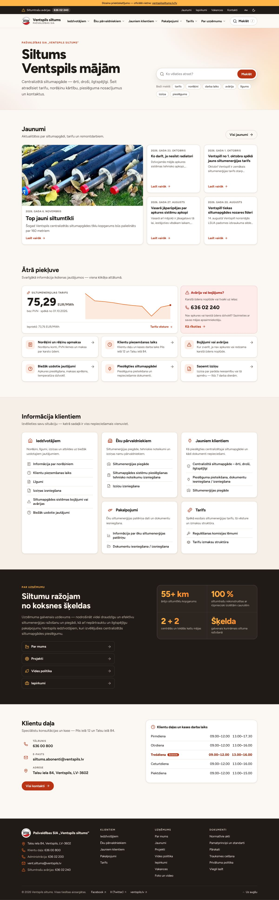

# Ventspils siltums — mājaslapas jaunais dizains

Vietnes [ventspilssiltums.lv](https://ventspilssiltums.lv/lv) pārveidota versija: tas pats saturs, bet ar jaunu
struktūru, dizainu un meklēšanu. Gatavā vietne ir mapē [`docs/`](docs/) — tā ir parasta statiska HTML vietne
bez servera puses koda.

> **Tas ir dizaina priekšskatījums.** Katras lapas augšā ir josla ar saiti uz oficiālo vietni, un lapas ir
> slēgtas meklētājprogrammām (`noindex`). Abus iestatījumus izslēdz failā `site.json`, kad vietne tiek palaista
> īstajā adresē.

## Kā apskatīt

```sh
python3 -m http.server 8000 --directory docs
```

Tad pārlūkā jāatver `http://localhost:8000`. Var arī vienkārši atvērt `docs/index.html` ar dubultklikšķi, vai
ieslēgt GitHub Pages (Settings → Pages → šis zars, mape `/docs`).

## Kas ir mainīts

| Bija | Tagad |
| --- | --- |
| Galvenajā izvēlnē tikai informācija par uzņēmumu; klientu sadaļas atrodamas tikai sākumlapā | Izvēlne sākas ar klientu sadaļām (Iedzīvotājiem, Ēku pārvaldniekiem, Jauniem klientiem, Pakalpojumi, Tarifs); uzņēmuma informācija sakārtota vienā izvēlnē „Par uzņēmumu” |
| Avāriju tālrunis atrodams atsevišķā lapā un kontaktu tabulas beigās | Avāriju tālrunis ir katras lapas augšā, sākumlapā un kontaktos — ar vienu pieskārienu zvanāms |
| Tarifs jāmeklē atsevišķā lapā | Spēkā esošais tarifs redzams sākumlapā; tarifa lapā — vēsture ar vizuālu salīdzinājumu |
| Meklēšanas lauks bez ieteikumiem | Tūlītēja meklēšana visā vietnē (taustiņš `/`), atrod arī bez garumzīmēm („avarija”) |
| Jaunumi pa 10 lapā, 64 lapas | Jaunumu arhīvs ar meklēšanu un gada filtru |
| Virsraksti un saites LIELIEM BURTIEM, teksts izlīdzināts abās malās | Parasta rakstība, kreisā mala, lasāms rindas garums |
| Dokumentu saites tekstā ar bildītēm | Dokumentu saraksti ar faila tipu (PDF, DOC, XLS) un izmēru |
| Tālruņa numuri kā teksts | Visi tālruņa numuri ir zvanāmas saites |
| Kontakti vienā lielā tabulā | Kontaktu kartītes (Klientu daļa ar darba laiku, administrācija, avārijas) un pilnā tabula zem tām |
| Iepirkumu tabulas telefonā jāritina sāniski | Telefonā tabulas rindas pārkārtojas par kartītēm |
| Sīkdatņu josla aizsedz saturu | Vietne neizmanto sīkdatnes; iestatījumi (tumšais režīms, teksta izmērs) glabājas tikai pārlūkā |

Papildus: gaišais un tumšais režīms, teksta izmēra poga, šodienas diena izcelta darba laika tabulās, navigācija
ar tastatūru, „Pāriet uz saturu” saite, teksta krāsu kontrasts pārbaudīts pret WCAG 2.1 AA (vismaz 4,5:1),
drukas stils. Bez JavaScript lapas joprojām ir lasāmas un izvēlne darbojas.



## Uzbūve

```
site.json            izvēlnes struktūra, kontakti, sākumlapas bloki
content/             lapu saturs (783 faili, importēti no esošās vietnes)
src/css/main.css     dizaina sistēma: krāsas, tipogrāfija, komponentes
src/js/main.js       izvēlne, meklēšana, jaunumu filtrs, galerija
src/icons/           ikonas (SVG)
src/fonts/, src/img/ fonts Figtree, logotipa zīme
tools/import_site.py satura imports no ventspilssiltums.lv
tools/build.py       ģenerators: content/ + src/ + site.json → docs/
tools/qa/            pārbaudes: saites, uzvedība, ekrāna platumi, ekrānuzņēmumi
docs/                uzbūvētā vietne
preview/             ekrānuzņēmumi
```

### Satura labošana

Katra lapa ir viens fails mapē `content/` — augšā neliels datu bloks (virsraksts, datums, attēls), zem tā
parasts HTML. Pēc izmaiņām vietni pārbūvē ar:

```sh
python3 tools/build.py
```

Ģeneratoram vajag tikai Python 3; papildu bibliotēkas nav nepieciešamas.

Tarifs sākumlapā un Klientu daļas darba laiks netiek rakstīti divreiz: ģenerators tos nolasa no lapām
`content/tarifs.html` (tabulas pirmā rinda) un `content/klientu-pienemsanas-laiks.html`. Tālruņi, e-pasti un
adrese galvenē un kājenē ir failā `site.json`.

### Satura atkārtots imports

```sh
pip install beautifulsoup4 lxml
python3 tools/import_site.py
python3 tools/build.py
```

Imports nolasa visas lapas no vietnes kartes, notīra Drupal marķējumu un pārraksta mapi `content/` — ar roku
veiktas izmaiņas tajā tiek aizstātas.

### Pārbaudes

Pēc izmaiņām dizainā vai skriptos vērts palaist trīs pārbaudes (vajadzīgs Node.js ar Playwright):

```sh
python3 -m http.server 8000 --directory docs &
python3 tools/qa/linkcheck.py   # bojātas iekšējās saites un atkārtoti id
node tools/qa/behave.js         # tastatūra, meklēšana, filtri, mobilā izvēlne, darbība bez JavaScript
node tools/qa/widths.js         # sāniska ritināšana 11 ekrāna platumos (320–1920 px)
```

`tools/qa/shots.js` uzņem ekrānuzņēmumus pēc saraksta JSON failā.

### Dizaina rīks Impeccable

Mapē `.claude/` ir [Impeccable](https://impeccable.style) — dizaina prasme Claude Code (komandas
`/impeccable critique`, `polish`, `audit` u. c.). Tā neietekmē pašu vietni. Rīka dzinējs (23 MB) repozitorijā
nav iekļauts: palaidējs to pirmajā reizē lejupielādē no projekta GitHub laidieniem un pārbauda kontrolsummu.
Dizaina pārbaudi var palaist arī ar roku:

```sh
.claude/skills/impeccable/scripts/impeccable detect http://localhost:8000/index.html
```

## Kas jāzina pirms palaišanas

- **Attēli un dokumenti** (`/sites/default/files/…`) netiek kopēti — saites ved uz esošo vietni. Pārceļot
  vietni, šī mape jāsaglabā tajā pašā adresē vai jāmaina `assetBase` failā `site.json`.
- **Logotips** ir izgriezts no esošās vietnes 55 px attēla. Vajadzētu aizstāt `src/img/logo-mark.png` ar
  vektoru vai lielāku attēlu.
- **Lielo burtu pārveide.** Virsraksti un saites, kas oriģinālā rakstītas LIELIEM BURTIEM, ir automātiski
  pārveidotas parastā rakstībā; īpašvārdu rakstība ņemta no pārējā vietnes teksta. Juridiski svarīgās lapās
  (statūti, ētikas kodekss, paziņojumi) to vērts pārlasīt.
- **Sākumlapas teksti** (ievads, sadaļu apraksti, skaitļi blokā „Par uzņēmumu”) ir rakstīti no jauna pēc
  esošā satura un atrodas `site.json` un `tools/build.py` — tos jāapstiprina uzņēmumam.
- **Lapu adreses** ir saglabātas, tikai bez `/lv` un ar `.html` galā (`/lv/tarifs` → `tarifs.html`). Pārejot
  jāiestata pāradresācija no vecajām adresēm.
- **Lapas, kas esošajā vietnē nav nevienā izvēlnē** (saraksts `site.json` → `unlisted`), ir uzbūvētas, lai
  to adreses darbotos, bet izvēlnēs un meklēšanā nav iekļautas. Jāizlemj, kuras no tām vēl ir aktuālas.
- Vietni var izmantot arī kā paraugu esošās Drupal tēmas pārveidei: `src/css/main.css` un HTML struktūra
  failā `tools/build.py` nav piesaistīta ģeneratoram.

## Licences

Fonts [Figtree](https://github.com/erikdkennedy/figtree) — SIL Open Font License. Ikonas
[Lucide](https://lucide.dev) — ISC licence. Licenču teksti ir blakus failiem mapēs `src/fonts` un `src/icons`.
